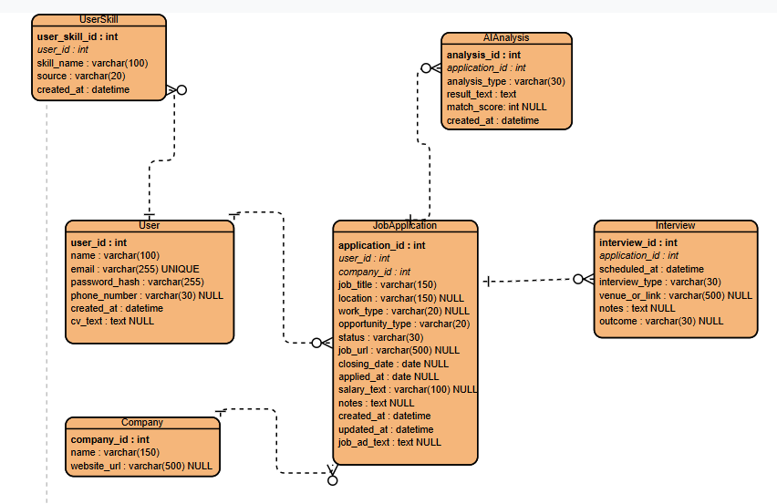

# Careerly database design (CAR-2)

## 1. Purpose and scope

This document describes the relational database design for Careerly, using Python, Flask and MySQL. The team has reviewed the six-table ERD and was happy with it. That review does not imply approval of every additional recommendation in this document. The design does not indicate that the database or planned features are implemented.

The core tracker comprises User, Company, JobApplication and Interview. UserSkill supports manual and planned CV-extracted skills; AIAnalysis stores results for planned interview preparation, missing-skills analysis and CV matching. CV extraction and AI generation are planned features and are not implemented in the current code.

## 2. Entities

| Entity | Purpose |
| --- | --- |
| User | Account identity, contact details and optional CV text. |
| UserSkill | A user's individual manual or CV-extracted skills. |
| Company | Employer details shared by application records. |
| JobApplication | A user's tracked opportunity, progress and job details. |
| Interview | A scheduled interview associated with an application. |
| AIAnalysis | A saved AI result associated with an application. |

## 3. Attribute definitions

Names, lengths and types follow the attached ERD. `NULL` annotations mean nullable; fields without that annotation are interpreted as NOT NULL, subject to team confirmation. All primary keys use signed `INT AUTO_INCREMENT`; all foreign keys use matching signed `INT`. Required fields without a default must be supplied when inserting a record. `None specified` means no default has been agreed; in particular, automatic timestamp defaults or update behaviour are not assumed. Rules requested for CAR-2 but absent from the diagram are identified in the review notes.

### User

| Attribute | MySQL type | PK/FK | Nullable | Default/constraint | Description |
| --- | --- | --- | --- | --- | --- |
| user_id | INT | PK | No | AUTO_INCREMENT | Account identifier. |
| name | VARCHAR(100) | - | No | None specified | User display name. |
| email | VARCHAR(255) | - | No | UNIQUE; no default specified | Account email address. |
| password_hash | VARCHAR(255) | - | No | Hash only; no default specified | Password hash, never a plaintext password. |
| phone_number | VARCHAR(30) | - | Yes | None specified | Optional contact number; text preserves formatting. |
| created_at | DATETIME | - | No | None specified | Account creation date and time. |
| cv_text | TEXT | - | Yes | None specified | CV text used by planned AI features. |

### UserSkill

| Attribute | MySQL type | PK/FK | Nullable | Default/constraint | Description |
| --- | --- | --- | --- | --- | --- |
| user_skill_id | INT | PK | No | AUTO_INCREMENT | Skill record identifier. |
| user_id | INT | FK -> User.user_id | No | None specified | Owner of this skill. |
| skill_name | VARCHAR(100) | - | No | UNIQUE (user_id, skill_name); no default specified | Name of the skill. |
| source | VARCHAR(20) | - | No | Allowed: ai_extracted, manual; no default specified | How the skill was added. |
| created_at | DATETIME | - | No | None specified | Skill record creation date and time. |

### Company

| Attribute | MySQL type | PK/FK | Nullable | Default/constraint | Description |
| --- | --- | --- | --- | --- | --- |
| company_id | INT | PK | No | AUTO_INCREMENT | Company identifier. |
| name | VARCHAR(150) | - | No | None specified | Employer name. |
| website_url | VARCHAR(500) | - | Yes | None specified | Optional employer website. |

### JobApplication

| Attribute | MySQL type | PK/FK | Nullable | Default/constraint | Description |
| --- | --- | --- | --- | --- | --- |
| application_id | INT | PK | No | AUTO_INCREMENT | Application identifier. |
| user_id | INT | FK -> User.user_id | No | None specified | User tracking the opportunity. |
| company_id | INT | FK -> Company.company_id | No | None specified | Employer for the opportunity. |
| job_title | VARCHAR(150) | - | No | None specified | Advertised role title. |
| location | VARCHAR(150) | - | Yes | None specified | Job location. |
| work_type | VARCHAR(20) | - | Yes | None specified; vocabulary to review | Working arrangement, such as remote or onsite. |
| opportunity_type | VARCHAR(20) | - | No | None specified; vocabulary to review | Opportunity category, such as internship. |
| status | VARCHAR(30) | - | No | DEFAULT 'Saved'; allowed: Saved, Applied, Interview, Offer, Rejected, Withdrawn | Current tracking stage. |
| job_url | VARCHAR(500) | - | Yes | None specified | Link to the job advertisement. |
| closing_date | DATE | - | Yes | None specified | Application deadline. |
| applied_at | DATE | - | Yes | None specified | Date the user applied; no time component. |
| salary_text | VARCHAR(100) | - | Yes | None specified | Salary wording or range; not a numeric amount. |
| notes | TEXT | - | Yes | None specified | User notes about the application. |
| created_at | DATETIME | - | No | None specified | Tracking record creation date and time. |
| updated_at | DATETIME | - | No | None specified | Most recent tracking record update time. |
| job_ad_text | TEXT | - | Yes | None specified | Saved advertisement text for planned analysis. |

### Interview

| Attribute | MySQL type | PK/FK | Nullable | Default/constraint | Description |
| --- | --- | --- | --- | --- | --- |
| interview_id | INT | PK | No | AUTO_INCREMENT | Interview identifier. |
| application_id | INT | FK -> JobApplication.application_id | No | None specified | Application this interview belongs to. |
| scheduled_at | DATETIME | - | No | None specified | Scheduled interview date and time. |
| interview_type | VARCHAR(30) | - | No | None specified; vocabulary to review | Interview format or stage. |
| venue_or_link | VARCHAR(500) | - | Yes | None specified | Physical venue or online meeting URL. |
| notes | TEXT | - | Yes | None specified | Preparation or follow-up notes. |
| outcome | VARCHAR(30) | - | Yes | None specified; vocabulary to review | Recorded interview result. |

### AIAnalysis

| Attribute | MySQL type | PK/FK | Nullable | Default/constraint | Description |
| --- | --- | --- | --- | --- | --- |
| analysis_id | INT | PK | No | AUTO_INCREMENT | Saved analysis identifier. |
| application_id | INT | FK -> JobApplication.application_id | No | None specified | Application analysed. |
| analysis_type | VARCHAR(30) | - | No | Allowed: interview_prep, missing_skills, cv_match; no default specified | Kind of generated result. |
| result_text | TEXT | - | No | None specified | Saved generated analysis content. |
| match_score | INT | - | Conditional | 0-100 for cv_match; NULL for other types; no default specified | Integer CV match score; required for cv_match. |
| created_at | DATETIME | - | No | None specified | Analysis generation/save date and time. |

### Confirmed CAR-2 design rules

These rules are requirements supplied for CAR-2. The reported teammate review covers the six-table ERD; it does not establish separate approval of every rule or recommendation omitted from the diagram.

- User.email is unique. UserSkill has a combined unique constraint on (user_id, skill_name), not a global unique skill name.
- UserSkill.source permits only `ai_extracted` or `manual`. Refreshing CV-extracted skills must preserve manually added skills and avoid duplicate (user_id, skill_name) pairs. If extraction finds a manual skill, keep the manual record.
- JobApplication.status defaults to `Saved` and permits only `Saved`, `Applied`, `Interview`, `Offer`, `Rejected` or `Withdrawn`.
- AIAnalysis.analysis_type permits only `interview_prep`, `missing_skills` or `cv_match`. For `cv_match`, match_score must be a non-NULL integer from 0 to 100 inclusive. For either other type, match_score must be NULL.
- Passwords must be stored as hashes in password_hash.
- Saved AI results reflect the inputs at generation time. Changed CV text, skills or job details require a new analysis; existing saved results must not be silently treated as current or overwritten by a refresh. Optional input provenance is discussed under Future considerations.

## 4. Relationships

Every relationship is one-to-many: a parent can have zero or many children, and each child belongs to exactly one parent. All five foreign keys are NOT NULL.

| Parent | Child | Actual foreign key | Cardinality |
| --- | --- | --- | --- |
| User | UserSkill | UserSkill.user_id -> User.user_id | 1 -> 0..many |
| User | JobApplication | JobApplication.user_id -> User.user_id | 1 -> 0..many |
| Company | JobApplication | JobApplication.company_id -> Company.company_id | 1 -> 0..many |
| JobApplication | Interview | Interview.application_id -> JobApplication.application_id | 1 -> 0..many |
| JobApplication | AIAnalysis | AIAnalysis.application_id -> JobApplication.application_id | 1 -> 0..many |

Multiple interviews and analyses may belong to the same application. No uniqueness constraint on their application_id is proposed.

## 5. Proposed deletion rules - awaiting team review

These are proposals, not agreed or implemented behaviour.

| Foreign key | Proposed parent deletion action | Effect |
| --- | --- | --- |
| UserSkill.user_id | CASCADE | Deleting a user deletes their skills. |
| JobApplication.user_id | CASCADE | Deleting a user deletes their applications and, through the application relationships below, their interviews and analyses. |
| JobApplication.company_id | RESTRICT | A company referenced by any application cannot be deleted. |
| Interview.application_id | CASCADE | Deleting an application deletes its interviews. |
| AIAnalysis.application_id | CASCADE | Deleting an application deletes its AI analyses. |

Deleting an application does not delete its company. A company with no remaining applications may be deleted. User deletion does not delete companies.

## 6. ERD

The supplied PNG is copied unchanged; it remains the source diagram, including any omissions noted below.

## 7. Review notes and decisions

### Comparison with existing code

- README.md describes a small Flask landing page/dashboard. app.py creates the Flask app and serves index.html at `/`; it contains no database connection, models, persistence, authentication or AI implementation.
- templates/index.html extends template.html. The base template displays Tracker, Browse and Interviews navigation and Login/Register labels, but supplies no database-backed forms or entity attribute names. The hard-coded profile name in a disabled template branch does not establish a User schema field.
- No model files exist in the inspected repository, and requirements.txt contains Flask and its dependencies without a MySQL driver or ORM. There are no implemented database field names to reconcile. These code gaps do not justify removing or renaming ERD attributes.

### ERD alignment and review scope

- The team has reviewed the six-table ERD and was happy with it. Additional recommendations, particularly deletion actions and optional input provenance, must not be treated as approved by that review.
- `JobApplication.applied_at` is labelled `date NULL` in the saved diagram. The attribute table now uses nullable `DATE`, correcting the earlier `DATETIME` transcription. The label is readable and has no apparent type ambiguity; it records a date without a time component.
- The diagram specifies `INT` identifiers without explicitly showing `AUTO_INCREMENT`. This document records `INT AUTO_INCREMENT` for all six primary keys as required by CAR-2; foreign keys remain matching signed `INT`.
- The diagram shows `User.email` as unique. It omits annotations for combined `UserSkill` uniqueness, source values, the status default and allowed values, analysis types and the conditional score rule. These CAR-2 requirements are documented above; the supplied image remains unchanged.
- `AIAnalysis.match_score` is shown as nullable `INT`. The CAR-2 rule refines that to required 0-100 for `cv_match` and NULL otherwise. No additional field is required for these value constraints.
- Optional attributes are explicitly marked `NULL`; the document interprets all other attributes as NOT NULL. This interpretation is stated explicitly because the diagram does not spell out every NOT NULL constraint.
- The diagram has no deletion actions. Section 5 remains a proposal awaiting approval, independently of the ERD review.

### Implementation decisions

These choices remain to be agreed during implementation; they are separate from the confirmed CAR-2 rules and the reported ERD review.

- Decide timestamp defaults, automatic `updated_at` behaviour and the timezone convention. No automatic defaults are assumed here; `DATETIME` carries no timezone. `applied_at` and `closing_date` use `DATE`.
- Agree skill-name normalisation, collation and email/skill case sensitivity while preserving manual skills and the combined uniqueness rule.
- Agree vocabularies for `work_type`, `opportunity_type`, `interview_type` and `outcome`. Examples in the tables do not define allowed values or additional uniqueness constraints.
- Select the target MySQL version and database/Flask validation mechanisms for allowed values and cross-field rules. The score rule must enforce both the range and the analysis-type/NULL combination.
- Select the password-hashing approach and input-validation policy. No enforcement or application changes are implemented by this document.

### Future considerations

An optional future enhancement is `AIAnalysis.input_snapshot`, potentially using MySQL `JSON` to retain the CV text, skills and job details used at generation time. It is outside the reviewed six-table attribute definitions and is not a CAR-2 completion requirement. If pursued, the team should separately agree its structure, nullability, defaults, privacy and retention policy, and whether a version or fingerprint is useful.

The current ERD does not retain input snapshots or versions, so exact input reconstruction and reliable stale-result detection cannot be derived from stored inputs alone. This limitation does not change the rule that saved results reflect generation-time inputs and changed inputs require a new analysis.

### CAR-2 completion and publication

Teammate review of the six-table ERD has happened, and the team was happy with it. Record that review evidence on CAR-2. Separately record the unapproved deletion proposals and outstanding implementation decisions so they are not mistaken for agreed behaviour. Optional future enhancements, including `input_snapshot`, do not block CAR-2 completion.

Merge and publication on the Database Structure page in Confluence remain outstanding. Complete the team's normal PR/merge process, publish the reviewed documentation, and link the resulting evidence to CAR-2 according to the team's Definition of Done. This work does not perform or claim merge or publication. Subsequent database implementation is outside this documentation task.
